  

# somtum.fun

somtum.fun is an [osu!](https://osu.ppy.sh) private server from Thailand. Since October 2026 it runs on **[TomYum-OSS](https://docs.somtum.fun)**, our own osu! server written in C#. It serves osu!(stable), osu!lazer (through our **TumThai** client) and the old 2008-2015 clients, all on **one shared leaderboard**. The website is a fork of ppy's own osu-web. Everything runs in Podman containers on one Oracle Cloud ARM machine, behind Cloudflare.

**Website:** [osu.somtum.fun](https://osu.somtum.fun) · **Docs:** [docs.somtum.fun](https://docs.somtum.fun)

## Service Architecture

```mermaid
flowchart TB
    subgraph Clients["Players"]
        stable(["osu!(stable)<br/>Somtum Launcher / Patcher"])
        legacy(["Old clients 2008-2015"])
        lazer(["TumThai (lazer)<br/>Windows · Linux · macOS · Android"])
        web(["Web Browser"])
        irc(["IRC clients & bots"])
        dclient(["Discord"])
    end

    subgraph CF["Cloudflare (DNS · CDN · DDoS · SSL)"]
        cf{{"Proxy & Cache"}}
    end

    subgraph OCI["Oracle Cloud — ARM VM, Podman"]
        hostcaddy{{"Host Caddy<br/>TLS (Cloudflare Origin cert)"}}
        caddy{{"Stack Caddy<br/>routing"}}

        subgraph Game["Game"]
            tomyum["TomYum<br/>(C# / .NET 10)<br/>bancho · /web · IRC · Discord bot"]
            spectator["tomyum-spectator<br/>(lazer multiplayer & spectating)"]
        end

        subgraph Website["Website"]
            osuweb["osu-web fork<br/>(PHP/Laravel + Octane)"]
            jobs["job · scheduler<br/>notification-server"]
        end

        subgraph Processing["Score processing"]
            scoreproc["score-processor<br/>(ppy's, pp & stats)"]
            indexer["score-indexer<br/>(ppy's)"]
            ppside["pp-sidecar ·<br/>difficulty-lookup-cache"]
            circleguard["circleguard<br/>(replay checks)"]
        end

        subgraph Others["Other services"]
            payments["payments-service<br/>(Python/FastAPI)"]
            qat["BN Management (qat)<br/>(Node.js)"]
        end

        subgraph Data["Data Stores"]
            mysql[("MySQL 8.4")]
            redis[("Redis 7.4")]
            es[("Elasticsearch 7.17")]
            mongo[("MongoDB 7<br/>(qat)")]
            files[("Files<br/>avatars · replays · beatmaps")]
            dl[("Downloads<br/>dl.somtum.fun")]
        end

        backup["Nightly backup<br/>(cron 04:30, 7 days)"]
    end

    subgraph ExternalAPIs["External APIs"]
        osuapi["osu! API"]
        mirror["catboy.best mirror"]
        discordapi["Discord"]
        truemoney["TrueMoney / PromptPay"]
        stripe["Stripe"]
    end

    stable & legacy -->|"c.somtum.fun"| cf
    lazer -->|"osu. / spectator.somtum.fun"| cf
    web --> cf
    cf --> hostcaddy --> caddy
    legacy -.->|"TCP bancho (pre-2014)"| tomyum
    irc -->|"irc.somtum.fun:6667"| tomyum
    dclient <--> tomyum

    caddy --> tomyum & osuweb & spectator
    hostcaddy --> payments & qat & dl

    osuweb --> mysql & redis & es
    jobs --> mysql & redis
    tomyum --> mysql & redis & files
    spectator --> mysql & redis
    scoreproc --> mysql
    indexer --> es
    tomyum --> ppside & circleguard
    qat --> mongo
    qat -->|"OAuth & groups"| osuweb
    payments -->|"supporter tags"| mysql

    tomyum --> osuapi & mirror & discordapi
    payments --> truemoney & stripe

    mysql & files --> backup

    classDef client fill:#e1f5fe,stroke:#01579b,color:#01579b
    classDef proxy fill:#fff3e0,stroke:#e65100,color:#e65100
    classDef game fill:#e8f5e9,stroke:#2e7d32,color:#1b5e20
    classDef internal fill:#f3e5f5,stroke:#7b1fa2,color:#4a148c
    classDef data fill:#fce4ec,stroke:#c2185b,color:#880e4f
    classDef external fill:#eceff1,stroke:#546e7a,color:#37474f
    classDef backup fill:#fff8e1,stroke:#f9a825,color:#f57f17

    class stable,legacy,lazer,web,irc,dclient client
    class cf,hostcaddy,caddy proxy
    class tomyum,spectator,osuweb,jobs,payments,qat game
    class scoreproc,indexer,ppside,circleguard internal
    class mysql,redis,es,mongo,files,dl data
    class osuapi,mirror,discordapi,truemoney,stripe external
    class backup backup
```

## Services

| Service | Language | Purpose |
|---|---|---|
| **TomYum** | C# / .NET 10 | The game server: bancho for stable and the old clients (HTTP and TCP), `/web` endpoints, lazer APIs, IRC, beatmap uploads, anti-cheat checks, the Discord bot (as a plugin) |
| **osu-web (fork)** | PHP / Laravel + TypeScript | The website: profiles, rankings, beatmaps, forums, wiki, news, store, staff panel; osu!'s API v2 for TumThai |
| **tomyum-spectator** | C# | lazer multiplayer, spectating and metadata (SignalR) |
| **score-processor / score-indexer** | C# (ppy's) | pp and stats for every score; search index of scores |
| **pp-sidecar / difficulty-lookup-cache** | C# | Difficulty and pp calculation |
| **circleguard** | Python | Replay checks after a score is submitted |
| **payments-service** | Python / FastAPI | The store: TrueMoney, PromptPay and Stripe |
| **BN Management (qat)** | Node.js + MongoDB | BN applications and evaluations at bn.somtum.fun |
| **Plugins** | C# | `tomyum.dan` (osu!dan), `tomyum.votes` (osu-server-list votes), bancho.py's v1 API, metrics, the Discord bot |

### Clients

| Client | What it is |
|---|---|
| **TumThai** | Our osu!lazer client (Windows, Linux, macOS, Android), the only lazer client that can submit scores |
| **Somtum Launcher** | Installs, updates and starts TumThai, osu!(stable) and the old clients (Windows and Linux) |
| **Somtum Patcher** | Starts osu!(stable) with our anti-cheat, plus Relax/Autopilot support |
| **Legacy clients** | 75 osu! builds from 2008 to 2015, rebuilt to run on somtum.fun with our anti-cheat |

## Communication Patterns

- **Shared database**: TomYum, the website, ppy's processors and payments-service all use the same MySQL (osu-web's schema), so stable and lazer scores sit in the same tables and the same leaderboards.
- **Redis**: sessions, cache and queues shared by TomYum and the website.
- **Elasticsearch**: score, beatmap, user and wiki search for the website.
- **HTTP**: the website ↔ TomYum (admin API, registration checks), qat ↔ the website (OAuth and groups).

### Score Submission Flow

1. **osu!(stable) and the old clients** send their score to TomYum (`c.somtum.fun` / `osu.somtum.fun/web`). **TumThai** gets a score token from the website's API v2 and submits there.
2. The anti-cheat must vouch for the client: TumThai is checked against our list of allowed builds, stable and the old clients need our anti-cheat running. Without that, players can still play, but scores don't submit.
3. The score is written to MySQL, and ppy's score-processor works out its pp and the player's stats.
4. The score-indexer puts it in Elasticsearch for the website's leaderboards and search.
5. circleguard checks the replay, and anything suspicious goes to staff on Discord.
6. The Discord bot posts new scores, and medals are awarded (including our custom medals).

### Beatmap Upload Flow

Players can host their own beatmaps, uploaded **in-game** from both stable (`osu-osz2-bmsubmit`) and lazer (beatmap submission):

1. TomYum checks the player's session and reads the `.osz`.
2. Maps that already exist on osu! are refused.
3. The set gets its own somtum.fun ID and is saved as **pending**.
4. The upload is posted on Discord; BNs and the NAT take it from there (bn.somtum.fun).

## Tech Stack

| Category | Technologies |
|---|---|
| **Languages** | C#, PHP, TypeScript, Python, JavaScript |
| **Frameworks** | ASP.NET Core (.NET 10), Laravel + Octane, FastAPI, SignalR |
| **Databases** | MySQL 8.4, Redis 7.4, Elasticsearch 7.17, MongoDB 7 |
| **Game client** | TumThai (fork of osu!lazer) |
| **Anti-cheat** | pkms (client side), circleguard (replays), build allow-list |
| **Containers** | Podman + Compose |
| **Reverse Proxy** | Caddy |
| **External APIs** | osu! API, catboy.best, Discord, TrueMoney, PromptPay, Stripe |

## Infrastructure

| Provider | Purpose |
|---|---|
| **Oracle Cloud** | ARM VM: hosts every service |
| **Cloudflare** | DNS, CDN, DDoS protection, SSL (Origin certificate) |
| **Caddy** | TLS on the host, routing inside the stack |
| **Podman** | Container runtime |

### Backups

Every night at 04:30 a backup dumps every database (`mysqldump --single-transaction`) and copies the game server's and website's files (avatars, replays, beatmaps, uploads). The last **7 days** are kept. The search index isn't backed up: it's rebuilt from the database.

### Domain Routing

| Domain | Service | Notes |
|---|---|---|
| `osu.somtum.fun` | Website + TomYum | The website and API v2; `/web/*` goes to TomYum |
| `c` / `c1`–`c6` / `ce` / `cho` `.somtum.fun` | TomYum | osu!(stable) bancho |
| `spectator.somtum.fun` | tomyum-spectator | lazer multiplayer, spectating, metadata |
| `a` / `b` / `s` / `assets` `.somtum.fun` | TomYum / website | Avatars, beatmap previews, static files |
| `api.somtum.fun` | TomYum | bancho.py-style API |
| `payment.somtum.fun` | payments-service | Store payments |
| `bn.somtum.fun` | qat | BN Management |
| `dl.somtum.fun` | Static files | TumThai, launcher, patcher and legacy client downloads |
| `docs.somtum.fun` | Static site | TomYum-OSS docs |
| `status.somtum.fun` | Gatus + Prometheus | Server status (monitored from a separate machine) |
| `somtum.fun` / `www` | Redirect | Old links go to `osu.somtum.fun` |
| `irc.somtum.fun:6667` | TomYum | IRC (DNS only) |
| `server.somtum.fun:13380-13384` | TomYum | TCP bancho for pre-2014 clients (DNS only) |

The web subdomains sit behind the Cloudflare proxy. IRC and the old TCP bancho connect directly.
